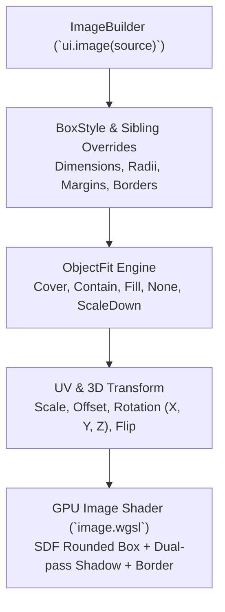

# Image API Specification & Unified Styling Architecture

`Image` is Zenthra's primary hardware-accelerated image widget (`ui.image(source)`), providing responsive rendering, object-fit mapping, GPU SDF corner rounding, drop shadows, 3D perspective rotation, UV zooming/panning, and complete `BoxStyle` unification.

The `Image` widget strictly adheres to the unified styling contract established in [`docs/api/macros.md`](./macros.md).

---

## Table of Contents

1. [Architectural Overview & GPU Pipeline](#1-architectural-overview--gpu-pipeline)
2. [Complete Image API Reference](#2-complete-image-api-reference)
   - [2.1 Construction & Sources](#21-construction--sources)
   - [2.2 Dimensions & Constraints (.width, .height, .aspect_ratio, .original_size)](#22-dimensions--constraints-width-height-aspect_ratio-original_size)
   - [2.3 BoxStyle Surface Styling (.radius, .border, .bg, .shadow, .opacity)](#23-boxstyle-surface-styling-radius-border-bg-shadow-opacity)
   - [2.4 Object-Fit Modes (.fit)](#24-object-fit-modes-fit)
   - [2.5 Advanced 3D & UV Transforms (.rotate, .zoom, .offset, .flip)](#25-advanced-3d--uv-transforms-rotate-zoom-offset-flip)
   - [2.6 Interaction States (.hover, .active)](#26-interaction-states-hover-active)
3. [Production Recipes & Patterns](#3-production-recipes--patterns)
   - [Recipe 1: Rounded Avatar with Sibling Hover Effects](#recipe-1-rounded-avatar-with-sibling-hover-effects)
   - [Recipe 2: Card Header Banner with ObjectFit::Cover](#recipe-2-card-header-banner-with-objectfitcover)
   - [Recipe 3: Interactive 3D Perspective Card Tilt](#recipe-3-interactive-3d-perspective-card-tilt)
4. [Anti-Patterns & Troubleshooting](#4-anti-patterns--troubleshooting)

---

## 1. Architectural Overview & GPU Pipeline

`ImageBuilder` implements `zenthra_core::Styleable`, unifying container dimensions, padding, margins, borders, backgrounds, and drop shadows into a canonical `pub style: BoxStyle`.

### Shader Pipeline Execution



1. **Geometry & Sizing**: Honors explicit `.width()` and `.height()`, bounded by `.min/max_width()` and `.min/max_height()`, falling back to aspect ratio preservation or native source dimensions.
2. **GPU SDF Inset**: Corners are rounded via analytical Signed Distance Fields (SDF) in the fragment shader, eliminating texture bleeding or jagged edges.
3. **State Blending**: Interactive states (`.hover([ ... ])`, `.active([ ... ])`) blend seamlessly with zero runtime overhead via canonical Sibling properties.

---

## 2. Complete Image API Reference

### 2.1 Construction & Sources

```rust
// On Ui:
pub fn image(&mut self, source: zenthra_core::ImageSource) -> ImageBuilder<'_, 'a>

// ImageSource options:
ImageSource::Path(PathBuf)
ImageSource::Bytes(Arc<[u8]>)
ImageSource::TextureId(u64)
```

---

### 2.2 Dimensions & Constraints (.width, .height, .aspect_ratio, .original_size)

`ImageBuilder` implements `zenthra_core::Styleable` and uses `impl_box_style_methods!`.

| Method | Type | Description |
| :--- | :--- | :--- |
| `.width(w: f32)` | Dimension | Explicit image width in logical pixels. |
| `.height(h: f32)` | Dimension | Explicit image height in logical pixels. |
| `.min_width(w)` / `.max_width(w)` | Constraints | Clamps calculated width bounds. |
| `.min_height(h)` / `.max_height(h)` | Constraints | Clamps calculated height bounds. |
| `.aspect_ratio(ratio: f32)` | Aspect Ratio | Overrides default image aspect ratio (`width / height`). |
| `.original_size()` | Intrinsic | Renders directly using the source texture's unscaled pixel dimensions. |
| `.margin(...)` / `.margin_all(...)` | Spacing | Outside spacing around the image element. |
| `.padding(...)` / `.padding_all(...)` | Spacing | Inset spacing between the outer frame and the image texture. |

---

### 2.3 BoxStyle Surface Styling (.radius, .border, .bg, .shadow, .opacity)

| Method | Description |
| :--- | :--- |
| `.radius_all(r: f32)` | Uniform corner radius across all four corners. |
| `.radius(tl, tr, br, bl)` | Granular per-corner radii. |
| `.radius_top(r)` / `.radius_bottom(r)` | Top or bottom corner radii. |
| `.border(impl IntoBorder)` | Border stroke `(Color, width)` or `Border::Solid(c, w)`. |
| `.bg(impl Into<Background>)` | Background color or gradient beneath transparent image pixels. |
| `.shadow(color, x, y, blur)` | Directional drop shadow rendered via multi-sample blur. |
| `.opacity(alpha: f32)` | Alpha multiplier from `0.0` (invisible) to `1.0` (fully opaque). |
| `.grayscale(amount: f32)` | Color desaturation filter from `0.0` (full color) to `1.0` (monochrome). |

---

### 2.4 Object-Fit Modes (.fit)

Controls how the image content scales within its bounded box:

```rust
pub enum ObjectFit {
    Fill,      // Stretches to fill bounds, ignoring aspect ratio
    Contain,   // Scales down to fit within bounds while preserving aspect ratio (default)
    Cover,     // Scales up to completely cover bounds while preserving aspect ratio
    None,      // Retains native source size without resizing
    ScaleDown, // Behave as Contain if larger than bounds, or None if smaller
}
```

Usage:
```rust
ui.image(source)
    .width(200.0)
    .height(200.0)
    .fit(ObjectFit::Cover)
    .show();
```

---

### 2.5 Advanced 3D & UV Transforms (.rotate, .zoom, .offset, .flip)

Fine-grained control over texture UVs and 3D perspective display:

| Method | Description |
| :--- | :--- |
| `.zoom(factor: f32)` | Zooms into or out of the image texture within its frame. |
| `.offset(x: f32, y: f32)` | Pans the texture UV coordinates horizontally and vertically. |
| `.rotate(x, y, z)` | Rotates the image in 3D degrees (perspective projection). |
| `.rotate_x(deg)` / `.rotate_y(deg)` / `.rotate_z(deg)` | Axis-specific 3D tilt. |
| `.flip_h(bool)` / `.flip_v(bool)` | Mirrors the texture horizontally or vertically. |

---

### 2.6 Interaction States (.hover, .active)

`ImageBuilder` supports the zero-cost canonical Sibling architecture for interaction states:

```rust
ui.image(source)
    .width(120.0)
    .height(120.0)
    .radius_all(16.0)
    .border((Color::rgb(0.2, 0.25, 0.35), 1.0))
    .hover([
        Style::border((Color::rgb(0.4, 0.7, 1.0), 2.0)),
        Style::shadow(Color::rgba(0.0, 0.0, 0.0, 0.4), 0.0, 6.0, 16.0),
        Transform::scale(1.05),
        Cursor::pointer(),
        Tooltip::new("Click to expand image"),
    ])
    .active([
        Transform::scale(0.98),
        Style::opacity(0.85),
    ])
    .show();
```

---

## 3. Production Recipes & Patterns

### Recipe 1: Rounded Avatar with Sibling Hover Effects

```rust
ui.image(avatar_source)
    .width(64.0)
    .height(64.0)
    .radius_all(32.0) // Circular avatar
    .fit(ObjectFit::Cover)
    .border((Color::rgb(0.3, 0.35, 0.45), 2.0))
    .shadow(Color::rgba(0.0, 0.0, 0.0, 0.3), 0.0, 4.0, 8.0)
    .hover([
        Style::border((Color::rgb(0.2, 0.6, 1.0), 2.5)),
        Transform::scale(1.08),
        Cursor::pointer(),
    ])
    .show();
```

---

### Recipe 2: Card Header Banner with ObjectFit::Cover

```rust
ui.image(banner_source)
    .fill_x()
    .height(180.0)
    .radius_top(12.0)
    .fit(ObjectFit::Cover)
    .bg(Color::rgb(0.08, 0.10, 0.14))
    .show();
```

---

### Recipe 3: Interactive 3D Perspective Card Tilt

```rust
let response = ui.image(cover_art)
    .width(240.0)
    .height(320.0)
    .radius_all(14.0)
    .rotate_y(15.0) // 15-degree 3D perspective tilt
    .shadow(Color::rgba(0.0, 0.0, 0.0, 0.5), 10.0, 15.0, 25.0)
    .hover([
        Transform::scale(1.04),
        Cursor::pointer(),
    ])
    .show();

if response.clicked {
    println!("Cover art clicked!");
}
```

---

## 4. Anti-Patterns & Troubleshooting

### ❌ Anti-Pattern 1: Legacy Pseudo-Methods
```rust
// ❌ COMPILE ERROR: Legacy pseudo-methods do not exist
ui.image(source)
    .hover_border(Color::RED)
    .hover_scale(1.05);

// ✅ CANONICAL: Use Sibling arrays
ui.image(source)
    .hover([
        Style::border((Color::RED, 1.5)),
        Transform::scale(1.05),
    ]);
```

### ❌ Anti-Pattern 2: Discarding Aspect Ratio on Unconstrained Images
```rust
// ❌ Distorts non-square images when fit is Fill
ui.image(source).width(200.0).height(100.0).fit(ObjectFit::Fill);

// ✅ Preserves visual fidelity
ui.image(source).width(200.0).height(100.0).fit(ObjectFit::Cover);
```
