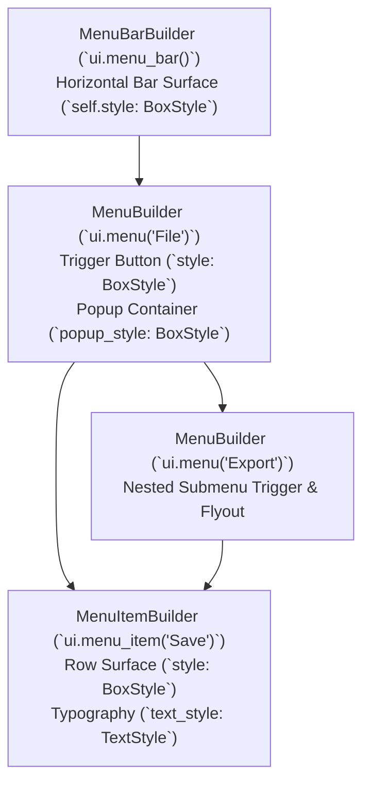

# Menu & MenuBar API Specification & Unified Styling Architecture

The `Menu` subsystem provides a complete desktop-grade hierarchical menu system for Zenthra UI, consisting of:
1. **`MenuBar`** (`ui.menu_bar()`): Horizontal application menu bar container.
2. **`Menu`** (`ui.menu("File")`): Top-level menu trigger or nested cascading submenu trigger.
3. **`MenuItem`** (`ui.menu_item("Save")`): Actionable menu row with shortcut readouts, icons, and click handling.

All three builders strictly adhere to the unified styling contract and zero-cost Sibling architecture established in [`docs/api/macros.md`](./macros.md).

---

## Table of Contents

1. [Architectural Overview & Sibling Parity](#1-architectural-overview--sibling-parity)
2. [Complete Menu API Reference](#2-complete-menu-api-reference)
   - [2.1 MenuBarBuilder (`ui.menu_bar()`)](#21-menubarbuilder-uimenu_bar)
   - [2.2 MenuBuilder (`ui.menu("Label")`)](#22-menubuilder-uimenulabel)
   - [2.3 MenuItemBuilder (`ui.menu_item("Label")`)](#23-menuitembuilder-uimenu_itemlabel)
3. [Component Structure & Interaction Flow](#3-component-structure--interaction-flow)
4. [Production Recipes & Patterns](#4-production-recipes--patterns)
   - [Recipe 1: Standard Desktop Application Menu Bar](#recipe-1-standard-desktop-application-menu-bar)
   - [Recipe 2: Deep Cascading Submenus with Icons & Shortcuts](#recipe-2-deep-cascading-submenus-with-icons--shortcuts)
   - [Recipe 3: Dark Cyberpunk & Glassmorphic Custom Menu](#recipe-3-dark-cyberpunk--glassmorphic-custom-menu)
5. [Anti-Patterns & Troubleshooting](#5-anti-patterns--troubleshooting)

---

## 1. Architectural Overview & Sibling Parity

### Three-Tier Builder Hierarchy



### Zero-Cost Sibling States

All interactive triggers and menu rows support domain-specific Siblings via `.hover([ ... ])` and `.active([ ... ])`:

```rust
// ✅ Canonical Zenthra Sibling architecture:
ui.menu_item("Preferences...")
    .shortcut("Ctrl+,")
    .hover([
        Style::bg(Color::rgb(0.20, 0.25, 0.35)),
        Text::color(Color::WHITE),
        Cursor::Pointer,
    ])
    .active([
        Transform::scale(0.98),
    ])
    .show();
```

---

## 2. Complete Menu API Reference

### 2.1 MenuBarBuilder (`ui.menu_bar()`)

Constructed via `ui.menu_bar()`. Implements `zenthra_core::Styleable` and uses `impl_box_style_methods!`.

| Method | Type | Description |
| :--- | :--- | :--- |
| `.height(h: f32)` | Dimension | Explicit height in logical pixels (default: `30.0`). |
| `.fill_x()` | Dimension | Expands horizontally across the viewport (default: `true`). |
| `.padding(t, r, b, l)` | Padding | Internal spacing around the menu triggers. |
| `.padding_all(p: f32)` | Padding | Uniform internal spacing. |
| `.padding_x(p: f32)` | Padding | Horizontal internal spacing (default: `8.0`). |
| `.bg(impl Into<Background>)` | Visual | Bar surface background (`Solid`, `Gradient`, or `None`). |
| `.border(impl IntoBorder)` | Visual | Stroke stroke `(Color, width)`. |
| `.shadow(color, x, y, blur)` | Visual | Drop shadow under the menu bar. |
| `.show(f: impl FnOnce(&mut Ui))` | Terminal | Renders the bar and yields execution to child items. |

---

### 2.2 MenuBuilder (`ui.menu("Label")`)

Constructed via `ui.menu(label)`. Implements `zenthra_core::Styleable`, `impl_box_style_methods!`, `impl_text_style_methods!`, and `impl_interaction_state_methods!`.

#### Trigger Button Styling (`BoxStyle` + `TextStyle`)

| Method | Description |
| :--- | :--- |
| `.height(h: f32)` / `.item_height(h)` | Trigger button height (default: `26.0`). |
| `.width(w: f32)` | Explicit trigger button width (if omitted, auto-sizes to content). |
| `.padding(t, r, b, l)` / `.padding_all(p)` | Trigger button internal padding (default: `symmetric(0.0, 10.0)`). |
| `.radius_all(r: f32)` | Corner radius of the trigger highlight (default: `4.0`). |
| `.bg(impl Into<Background>)` | Trigger idle background. |
| `.size(f32)` | Label font size (default: `13.0`). |
| `.color(Color)` | Label text color. |
| `.font_family(impl Into<String>)` | Custom font family for the trigger label. |
| `.hover([ ... ])` | Sibling hover overrides (`Style::*`, `Text::*`, `Cursor::*`). |
| `.active([ ... ])` | Sibling active overrides (`Style::*`, `Transform::*`). |

#### Flyout Popup Styling (`popup_style: BoxStyle`)

| Method | Description |
| :--- | :--- |
| `.menu_width(w: f32)` | Width of the floating popup container (default: `270.0`). |
| `.popup_style(BoxStyle)` | Replaces entire popup container `BoxStyle`. |
| `.popup_bg(impl Into<Background>)` | Popup surface background (Solid or Gradient). |
| `.popup_border(impl IntoBorder)` | Popup outline border stroke `(Color, width)`. |
| `.popup_radius(r: f32)` | Corner radius of the floating popup (default: `4.0`). |
| `.popup_padding(t, r, b, l)` | Internal padding around menu rows (default: `all(4.0)`). |
| `.popup_shadow(color, x, y, blur)` | Drop shadow underneath the flyout popup. |
| `.placement(Placement)` | Flyout placement (`Placement::Bottom`, `Placement::Right`, etc.). |
| `.align(PopoverAlign)` | Alignment relative to trigger (`Start`, `Center`, `End`). |
| `.gap(f32)` | Spacing gap between trigger and popup (default: `2.0`). |

---

### 2.3 MenuItemBuilder (`ui.menu_item("Label")`)

Constructed via `ui.menu_item(label)`. Implements `zenthra_core::Styleable`, `impl_box_style_methods!`, `impl_text_style_methods!`, and `impl_interaction_state_methods!`.

| Method | Description |
| :--- | :--- |
| `.shortcut(impl Into<String>)` | Right-aligned keyboard shortcut readout (e.g. `"Ctrl+S"`, `"Alt+F4"`). |
| `.icon(impl Into<String>)` | Leading icon string (e.g. NerdFont glyph or text icon). |
| `.height(h: f32)` | Row item height (default: `26.0`). |
| `.width(w: f32)` | Row item width (default: `262.0`). |
| `.radius_all(r: f32)` | Hover highlight corner radius (default: `3.0`). |
| `.padding(t, r, b, l)` | Row internal padding (default: `symmetric(0.0, 8.0)`). |
| `.bg(impl Into<Background>)` | Row idle background. |
| `.size(f32)` | Typography font size (default: `13.0`). |
| `.color(Color)` | Typography label color. |
| `.hover([ ... ])` | Sibling hover overrides (`Style::bg(...)`, `Text::color(...)`, `Cursor::Pointer`). |
| `.active([ ... ])` | Sibling active overrides (`Transform::scale(...)`). |
| `.show() -> Response` | Renders the item, closes all menus on click, and returns `Response`. |

---

## 3. Production Recipes & Patterns

### Recipe 1: Standard Desktop Application Menu Bar

```rust
ui.menu_bar()
    .height(30.0)
    .bg(Color::rgb(0.10, 0.11, 0.14))
    .show(|ui| {
        // File Menu
        ui.menu("File")
            .menu_width(240.0)
            .show(|ui| {
                if ui.menu_item("New Project").shortcut("Ctrl+N").show().clicked {
                    // Handle new project
                }
                if ui.menu_item("Open File...").shortcut("Ctrl+O").show().clicked {
                    // Handle open file
                }
                ui.spacing(4.0);
                if ui.menu_item("Save").shortcut("Ctrl+S").show().clicked {
                    // Handle save
                }
                if ui.menu_item("Save As...").shortcut("Ctrl+Shift+S").show().clicked {
                    // Handle save as
                }
                ui.spacing(4.0);
                if ui.menu_item("Exit").shortcut("Alt+F4").show().clicked {
                    // Handle exit
                }
            });

        // Edit Menu
        ui.menu("Edit")
            .menu_width(220.0)
            .show(|ui| {
                ui.menu_item("Undo").shortcut("Ctrl+Z").show();
                ui.menu_item("Redo").shortcut("Ctrl+Y").show();
                ui.spacing(4.0);
                ui.menu_item("Cut").shortcut("Ctrl+X").show();
                ui.menu_item("Copy").shortcut("Ctrl+C").show();
                ui.menu_item("Paste").shortcut("Ctrl+V").show();
            });
    });
```

### Recipe 2: Deep Cascading Submenus with Icons & Shortcuts

```rust
ui.menu("Export")
    .menu_width(250.0)
    .show(|ui| {
        ui.menu_item("Quick Export PNG").shortcut("Ctrl+Shift+E").show();
        ui.spacing(4.0);

        // Cascading Submenu
        ui.menu("Vector Formats")
            .submenu(true)
            .menu_width(200.0)
            .show(|ui| {
                ui.menu_item("SVG (.svg)").show();
                ui.menu_item("PDF Document (.pdf)").show();
                ui.menu_item("PostScript (.eps)").show();
            });

        ui.menu("Raster Formats")
            .submenu(true)
            .menu_width(200.0)
            .show(|ui| {
                ui.menu_item("JPEG (.jpg)").show();
                ui.menu_item("WebP (.webp)").show();
                ui.menu_item("TIFF (.tiff)").show();
            });
    });
```

### Recipe 3: Dark Cyberpunk & Glassmorphic Custom Menu

```rust
ui.menu("Settings")
    .bg(Color::rgb(0.08, 0.09, 0.12))
    .border((Color::rgb(0.2, 0.25, 0.35), 1.0))
    .radius_all(6.0)
    .hover([
        Style::bg(Color::rgb(0.14, 0.16, 0.24)),
        Text::color(Color::rgb(0.45, 0.75, 1.0)),
        Cursor::Pointer,
    ])
    .popup_bg(Color::rgba(0.06, 0.07, 0.10, 0.85))
    .popup_border((Color::rgb(0.35, 0.65, 1.0), 1.5))
    .popup_radius(8.0)
    .popup_shadow(Color::rgba(0.0, 0.0, 0.0, 0.6), 0.0, 8.0, 24.0)
    .menu_width(260.0)
    .show(|ui| {
        ui.menu_item("Audio Device")
            .hover([
                Style::bg(Color::rgb(0.18, 0.22, 0.32)),
                Text::color(Color::WHITE),
            ])
            .show();
        ui.menu_item("Graphics Pipeline")
            .hover([
                Style::bg(Color::rgb(0.18, 0.22, 0.32)),
                Text::color(Color::WHITE),
            ])
            .show();
    });
```

---

## 4. Anti-Patterns & Troubleshooting

| Anti-Pattern | Recommended Practice |
| :--- | :--- |
| **Using legacy ad-hoc methods** (`.hover_bg()`, `.active_border()`) | Always use zero-cost Siblings: `.hover([ Style::bg(...), Text::color(...) ])`. |
| **Assuming `.width()` sets popup width on `MenuBuilder`** | `.width(w)` sets the **trigger button** width; use `.menu_width(w)` to configure flyout popup width. |
| **Forgetting to check `.clicked` on `MenuItem::show()`** | Always inspect the returned `Response`: `if ui.menu_item("Save").show().clicked { ... }`. |
| **Manually closing menus after item clicks** | `MenuItem::show()` automatically dispatches `close_all_menus(ui)` upon selection. |
