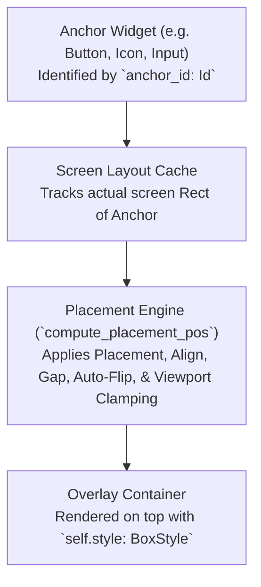

# Popover API Specification & Unified Styling Architecture

`Popover` provides floating, anchored overlay containers that position themselves relative to any anchor widget in the viewport. It features intelligent edge detection, auto-flipping, viewport boundary clamping, optional backdrop blur, and full `BoxStyle` unification.

The `Popover` widget strictly adheres to the unified styling contract established in [`docs/api/macros.md`](./macros.md).

---

## Table of Contents

1. [Architectural Overview & Placement Engine](#1-architectural-overview--placement-engine)
2. [Complete Popover API Reference](#2-complete-popover-api-reference)
   - [2.1 Construction & Anchoring](#21-construction--anchoring)
   - [2.2 Placement & Alignment (.placement, .align, .gap, .auto_flip)](#22-placement--alignment-placement-align-gap-auto_flip)
   - [2.3 Dimensions & Layout (.width, .height, .padding, .margin)](#23-dimensions--layout-width-height-padding-margin)
   - [2.4 Container Surface Styling (`BoxStyle` Parity)](#24-container-surface-styling-boxstyle-parity)
   - [2.5 Corner Radii & Shadows](#25-corner-radii--shadows)
   - [2.6 Backdrop Filters & Blur](#26-backdrop-filters--blur)
   - [2.7 Overlay Execution & Dismissal (.show, .show_toggle)](#27-overlay-execution--dismissal-show-show_toggle)
3. [Production Recipes & Patterns](#3-production-recipes--patterns)
   - [Recipe 1: User Profile Flyout Card](#recipe-1-user-profile-flyout-card)
   - [Recipe 2: Color Picker Popover with Auto-Flip](#recipe-2-color-picker-popover-with-auto-flip)
   - [Recipe 3: Glassmorphic Contextual Help Tooltip Card](#recipe-3-glassmorphic-contextual-help-tooltip-card)
4. [Anti-Patterns & Troubleshooting](#4-anti-patterns--troubleshooting)

---

## 1. Architectural Overview & Placement Engine

### Floating Overlay Architecture

A `Popover` renders directly into the top-level overlay pass using the target `anchor_id`'s bounding box:



### Auto-Flipping & Viewport Clamping
If a popover placed with `Placement::Bottom` exceeds the bottom viewport edge, the placement engine automatically flips it to `Placement::Top` (if space permits). All coordinates are clamped within the active viewport bounds `[8.0, viewport - 8.0]`.

---

## 2. Complete Popover API Reference

### 2.1 Construction & Anchoring

```rust
// On Ui:
pub fn popover(&mut self, anchor_id: zenthra_core::Id) -> PopoverBuilder<'_, 'a>
```

---

### 2.2 Placement & Alignment (.placement, .align, .gap, .auto_flip)

| Method | Type | Description |
| :--- | :--- | :--- |
| `.placement(Placement)` | Placement | Primary anchor edge: `Bottom`, `Top`, `Left`, `Right`, or `Custom(ox, oy)` (default: `Bottom`). |
| `.align(PopoverAlign)` | Alignment | Alignment along the orthogonal edge: `Start`, `Center`, `End` (default: `Start`). |
| `.gap(f32)` | Spacing | Distance in pixels between anchor widget and popover edge (default: `4.0`). |
| `.auto_flip(bool)` | Adaptive | Automatically flips placement if it would overflow the screen (default: `true`). |

---

### 2.3 Dimensions & Layout (.width, .height, .padding, .margin)

`PopoverBuilder` implements `zenthra_core::Styleable` and uses `impl_box_style_methods!`.

| Method | Description |
| :--- | :--- |
| `.width(w: f32)` | Explicit width in logical pixels (default: `200.0`). |
| `.height(h: f32)` | Explicit fixed height (if omitted, auto-sizes to child content). |
| `.padding(t, r, b, l)` | Per-edge internal padding around popover content. |
| `.padding_all(p: f32)` | Uniform internal padding (default: `4.0`). |
| `.padding_x(px)` / `.padding_y(py)` | Axis-specific internal padding. |
| `.margin(t, r, b, l)` / `.margin_all(m)` | Outer container spacing. |

---

### 2.4 Container Surface Styling (`BoxStyle` Parity)

| Method | Description |
| :--- | :--- |
| `.style(BoxStyle)` | Replaces entire underlying container `BoxStyle`. |
| `.bg(impl Into<Background>)` | Surface background (`Solid`, `Gradient`, or `None`). Default: `rgb(0.10, 0.10, 0.12)`. |
| `.border(impl IntoBorder)` | Border stroke `(Color, width)`. Default: `(rgb(0.20, 0.20, 0.24), 1.0)`. |
| `.shadow(color, x, y, blur)` | Drop shadow underneath the popover. Default: `(rgba(0, 0, 0, 0.5), 0, 4, 16)`. |

---

### 2.5 Corner Radii & Shadows

| Method | Description |
| :--- | :--- |
| `.radius_all(r: f32)` | Uniform radius across all 4 corners (default: `6.0`). |
| `.radius(tl, tr, br, bl)` | Individual corner radii. |

---

### 2.6 Backdrop Filters & Blur

| Method | Description |
| :--- | :--- |
| `.backdrop_blur(radius: f32)` | Applies GPU backdrop blur to everything underneath the popover. |
| `.backdrop_filter(BackdropFilter)` | Custom shader backdrop filter pipeline. |

---

### 2.7 Overlay Execution & Dismissal (.show, .show_toggle)

```rust
// Standard rendering
pub fn show<F>(self, f: F) -> Response
where F: FnOnce(&mut Ui)

// Automatic outside-click dismissal
pub fn show_toggle<F>(self, is_open: &mut bool, f: F) -> Response
where F: FnOnce(&mut Ui)
```

---

## 3. Production Recipes & Patterns

### Recipe 1: User Profile Flyout Card

```rust
let avatar_id = ui.id_from("user_avatar_btn");
if ui.button("👤 Profile").id(avatar_id).show().clicked {
    profile_popover_open = !profile_popover_open;
}

if profile_popover_open {
    ui.popover(avatar_id)
        .placement(Placement::Bottom)
        .align(PopoverAlign::End)
        .width(240.0)
        .bg(Color::rgb(0.12, 0.13, 0.17))
        .border((Color::rgb(0.22, 0.25, 0.35), 1.0))
        .radius_all(8.0)
        .padding_all(12.0)
        .shadow(Color::rgba(0.0, 0.0, 0.0, 0.6), 0.0, 8.0, 24.0)
        .show_toggle(&mut profile_popover_open, |ui| {
            ui.text("Alice Henderson").size(15.0).bold().show();
            ui.text("alice@example.com").size(12.0).color(Color::rgb(0.6, 0.6, 0.7)).show();
            ui.spacing(12.0);
            if ui.button("Account Settings").show().clicked {
                // Navigate
            }
            if ui.button("Sign Out").show().clicked {
                // Log out
            }
        });
}
```

### Recipe 2: Color Picker Popover with Auto-Flip

```rust
let swatch_id = ui.id_from("color_swatch_1");

if picker_open {
    ui.popover(swatch_id)
        .placement(Placement::Right)
        .align(PopoverAlign::Center)
        .gap(8.0)
        .auto_flip(true)
        .width(180.0)
        .bg(Color::rgb(0.08, 0.09, 0.12))
        .border((Color::rgb(0.3, 0.5, 0.9), 1.5))
        .radius_all(6.0)
        .padding_all(8.0)
        .show_toggle(&mut picker_open, |ui| {
            ui.text("Select Swatch").size(12.0).show();
            ui.spacing(6.0);
            // Render color swatch grid
        });
}
```

### Recipe 3: Glassmorphic Contextual Help Tooltip Card

```rust
ui.popover(help_icon_id)
    .placement(Placement::Top)
    .align(PopoverAlign::Center)
    .width(280.0)
    .bg(Color::rgba(0.10, 0.12, 0.18, 0.75))
    .backdrop_blur(16.0)
    .border((Color::rgba(255.0, 255.0, 255.0, 0.12), 1.0))
    .radius_all(10.0)
    .padding_all(14.0)
    .show(|ui| {
        ui.text("Hardware Acceleration").bold().size(13.0).show();
        ui.text("Enables Vulkan / Metal low-level GPU synchronization primitives.")
            .size(12.0)
            .color(Color::rgb(0.75, 0.78, 0.85))
            .show();
    });
```

---

## 4. Anti-Patterns & Troubleshooting

| Anti-Pattern | Recommended Practice |
| :--- | :--- |
| **Using unrecorded or temporary IDs as `anchor_id`** | Always ensure the anchor widget has a stable ID (`ui.id_from("...")` or `.id(...)`) that renders before the popover. |
| **Manually handling outside clicks with complex state** | Use `.show_toggle(&mut is_open, ...)` which automatically handles outside-click detection and dismissal. |
| **Hardcoding fixed coordinates instead of placement** | Prefer `.placement(Placement::*)` and `.align(PopoverAlign::*)` to keep the popover responsive to window resizing. |
