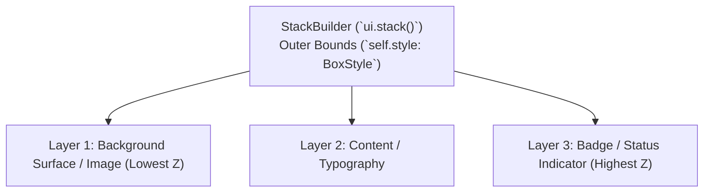

# Stack Layout API Specification & Unified Styling Architecture

`Stack` is Zenthra's primary multi-layer layout container (`ui.stack()`), allowing multiple child widgets to occupy the same spatial bounding box. Children are positioned relative to each other along the Z-axis, with support for cross-axis alignment (`halign`, `valign`), custom dimensions, clipping, and complete `BoxStyle` unification.

The `Stack` layout container strictly adheres to the unified styling contract established in [`docs/api/macros.md`](./macros.md).

---

## Table of Contents

1. [Architectural Overview & Z-Index Layering](#1-architectural-overview--z-index-layering)
2. [Complete Stack API Reference](#2-complete-stack-api-reference)
   - [2.1 Construction & Unique IDs](#21-construction--unique-ids)
   - [2.2 Dimensions & Constraints (.width, .height, .fill_x, .fill_y, .fill)](#22-dimensions--constraints-width-height-fill_x-fill_y-fill)
   - [2.3 Container Surface Styling (`BoxStyle` Parity)](#23-container-surface-styling-boxstyle-parity)
   - [2.4 Corner Radii & Shadows](#24-corner-radii--shadows)
   - [2.5 Spacing & Padding (.padding, .padding_all, .margin)](#25-spacing--padding-padding-padding_all-margin)
   - [2.6 Child Alignment & Positioning (.halign, .valign, .align)](#26-child-alignment--positioning-halign-valign-align)
   - [2.7 Overlay & Absolute Mode (.overlay, .absolute, .clip)](#27-overlay--absolute-mode-overlay-absolute-clip)
3. [Production Recipes & Patterns](#3-production-recipes--patterns)
   - [Recipe 1: Badge Over Avatar Indicator](#recipe-1-badge-over-avatar-indicator)
   - [Recipe 2: Card with Gradient Background & Centered Content](#recipe-2-card-with-gradient-background--centered-content)
   - [Recipe 3: Floating Action Button in Corner](#recipe-3-floating-action-button-in-corner)
4. [Anti-Patterns & Troubleshooting](#4-anti-patterns--troubleshooting)

---

## 1. Architectural Overview & Z-Index Layering

### Overlapping Child Execution

Children declared inside `ui.stack().show(|ui| { ... })` render in declaration order:
- The **first child** renders at the bottom of the stack (lowest Z-index).
- Subsequent children render on top of preceding children.
- Mouse hit-testing operates in reverse order (topmost layer receives first interaction priority).



---

## 2. Complete Stack API Reference

### 2.1 Construction & Unique IDs

```rust
// On Ui:
pub fn stack(&mut self) -> StackBuilder<'_, 'a>

// On StackBuilder:
pub fn id(mut self, id: impl std::hash::Hash) -> Self
```

---

### 2.2 Dimensions & Constraints (.width, .height, .fill_x, .fill_y, .fill)

`StackBuilder` implements `zenthra_core::Styleable` and uses `impl_box_style_methods!`.

| Method | Type | Description |
| :--- | :--- | :--- |
| `.width(w: f32)` | Dimension | Explicit width in logical pixels. |
| `.height(h: f32)` | Dimension | Explicit height in logical pixels. |
| `.fill_x()` | Dimension | Expands horizontally to fill parent container width. |
| `.fill_y()` | Dimension | Expands vertically to fill parent container height. |
| `.fill()` | Dimension | Expands in both horizontal and vertical directions. |
| `.min_width(w)` / `.max_width(w)` | Constraints | Clamps calculated width bounds. |
| `.min_height(h)` / `.max_height(h)` | Constraints | Clamps calculated height bounds. |

---

### 2.3 Container Surface Styling (`BoxStyle` Parity)

| Method | Description |
| :--- | :--- |
| `.style(BoxStyle)` | Replaces entire underlying `BoxStyle`. |
| `.bg(impl Into<Background>)` | Surface background (`Solid`, `Gradient`, or `None`). |
| `.border(impl IntoBorder)` | Border stroke `(Color, width)` or `Border::None`. |
| `.shadow(color, x, y, blur)` | Drop shadow underneath the stack. |

---

### 2.4 Corner Radii & Shadows

| Method | Description |
| :--- | :--- |
| `.radius_all(r: f32)` | Uniform radius across all 4 corners. |
| `.radius(tl, tr, br, bl)` | Individual corner radii. |
| `.radius_top(r)` / `.radius_bottom(r)` | Axis-specific corner radii. |

---

### 2.5 Spacing & Padding (.padding, .padding_all, .margin)

| Method | Description |
| :--- | :--- |
| `.padding(t, r, b, l)` | Per-edge internal padding offsetting children. |
| `.padding_all(p: f32)` | Uniform internal padding. |
| `.padding_x(px)` / `.padding_y(py)` | Horizontal / vertical internal padding. |
| `.margin(t, r, b, l)` / `.margin_all(m)` | Outer container spacing. |

---

### 2.6 Child Alignment & Positioning (.halign, .valign, .align)

Controls how children smaller than the stack bounds are anchored within the stack:

| Method | Values | Description |
| :--- | :--- | :--- |
| `.halign(Align)` | `Left`, `Center`, `Right` | Horizontal positioning of child layers. |
| `.valign(Align)` | `Top`, `Center`, `Bottom` | Vertical positioning of child layers. |
| `.align(h: Align, v: Align)` | Pairs | Convenience setter for both axes. |

---

### 2.7 Overlay & Absolute Mode (.overlay, .absolute, .clip)

| Method | Description |
| :--- | :--- |
| `.clip(bool)` | Restricts drawing commands of children to the stack bounds. |
| `.overlay()` | Routes all child drawing commands to the top-level overlay pass. |
| `.absolute()` | Does not advance parent layout cursor when rendered. |

---

## 3. Production Recipes & Patterns

### Recipe 1: Badge Over Avatar Indicator

```rust
ui.stack()
    .width(48.0)
    .height(48.0)
    .show(|ui| {
        // Base: Avatar Surface
        ui.container()
            .width(48.0)
            .height(48.0)
            .radius_all(24.0)
            .bg(Color::rgb(0.2, 0.3, 0.5))
            .show(|_| {});

        // Top: Online Status Indicator Dot
        ui.container()
            .width(12.0)
            .height(12.0)
            .radius_all(6.0)
            .bg(Color::rgb(0.2, 0.8, 0.3))
            .border((Color::rgb(0.08, 0.09, 0.12), 2.0))
            .show(|_| {});
    });
```

### Recipe 2: Card with Gradient Background & Centered Content

```rust
ui.stack()
    .width(280.0)
    .height(140.0)
    .radius_all(12.0)
    .bg(Gradient::linear(
        [Color::rgb(0.15, 0.18, 0.28), Color::rgb(0.08, 0.09, 0.14)],
        GradientDirection::TopLeftToBottomRight,
    ))
    .border((Color::rgb(0.3, 0.35, 0.5), 1.0))
    .shadow(Color::rgba(0.0, 0.0, 0.0, 0.4), 0.0, 6.0, 16.0)
    .align(Align::Center, Align::Center)
    .show(|ui| {
        ui.container().column().gap(4.0).show(|ui| {
            ui.text("Featured Asset").size(16.0).bold().show();
            ui.text("Ready to export").size(12.0).color(Color::rgb(0.6, 0.65, 0.75)).show();
        });
    });
```

### Recipe 3: Floating Action Button in Corner

```rust
ui.stack()
    .fill_x()
    .height(300.0)
    .align(Align::Right, Align::Bottom)
    .padding_all(16.0)
    .show(|ui| {
        // Main view content
        ui.text("Workspace Canvas").show();

        // FAB pinned to bottom-right
        if ui.button("+ Add Layer")
            .bg(Color::rgb(0.2, 0.5, 0.9))
            .radius_all(20.0)
            .show().clicked
        {
            // Action
        }
    });
```

---

## 4. Anti-Patterns & Troubleshooting

| Anti-Pattern | Recommended Practice |
| :--- | :--- |
| **Using `ui.container()` when overlapping children are needed** | Use `ui.stack()`; containers layout children sequentially along an axis (row/column). |
| **Assuming `.show()` automatically clips child overflow** | Use `.clip(true)` if child elements should be strictly masked to the stack bounds. |
| **Forgetting to specify stack dimensions when children are absolutely positioned** | Provide explicit `.width(...)` and `.height(...)` or `.fill_x() / .fill_y()` when children don't define natural bounds. |
